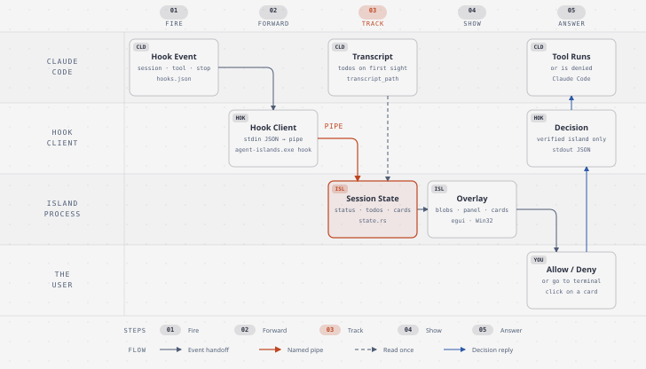

<div align="center">

# Agent Islands

A dynamic-island style overlay for Claude Code sessions on Windows.<br>
See every session at a glance, follow its todos, and answer permission prompts without hunting for the right terminal.

<p>
  
  
  
  
</p>

<p>
  
  
  
  
  
  
</p>

<a href="#tech-stack"></a>

</div>

---

## Features

- **One blob per session.** Working sessions bounce, waiting ones stand out, idle ones dim. Each session keeps its own color.
- **Live todos.** The panel shows each session's todo list as Claude updates it. After an island restart, the list is rebuilt from the session transcript.
- **Answer from the island.** Permission prompts open a card with Allow and Deny. With no answer within 30 seconds, the normal terminal prompt takes over.
- **Go to terminal.** Questions and waiting sessions get a button that brings the right Windows Terminal window and tab to the front.
- **Command gate.** Risky shell commands always ask on the island, even in auto mode: `rm`, `del`, `Remove-Item`, `git commit`, `git push`, `git reset`, and package installs (`npm`, `pnpm`, `yarn`, `bun`, `pip`, `uv`, `cargo`).
- **Finished pill.** Shows sessions that stopped while you looked elsewhere. Click it to clear.
- **Left or right.** Right-click the pill to dock the island on either side of the screen.
- **Stays out of the way.** It never steals typing focus, clicks pass through its transparent areas, and it exits about 3 seconds after the last session ends.

## How it works

<picture>
  <source media="(prefers-color-scheme: dark)" srcset="docs/diagrams/dataflow-dark.svg">
  
</picture>

1. **Fire.** Claude Code runs `agent-islands.exe hook` for each event registered in `plugin/hooks/hooks.json`.
2. **Forward.** The hook client reads the event JSON from stdin and sends it over a named pipe. If no island is running, it starts one.
3. **Track.** The island updates its session state: status, todos and open cards. The first time it sees a session, it reads the session transcript to rebuild the todo list.
4. **Show.** The overlay draws the blobs, the panel and the cards with egui on a click-through Win32 window.
5. **Answer.** Your click goes back through the pipe. The hook client prints the decision JSON for Claude Code. It does so only when the island is verified as the same build (the exe content is hashed). Otherwise it never allows anything.

## Install

Needs Rust (stable) and Windows 10 or 11.

```powershell
powershell -File .\build-plugin.ps1
```

This builds the exe into `plugin\bin\`. Then, in Claude Code:

```text
/plugin marketplace add D:\projects\agent-islands
/plugin install agent-islands@agent-islands-local
```

Use this repo's path in the first command. Restart running Claude Code sessions. The plugin applies to every session, and the island starts itself on the first hook event.

## Update after code changes

1. Run `powershell -File .\build-plugin.ps1`.
   - It stops any running island from `plugin\bin` or the plugin cache.
   - It rebuilds, copies the exe, and bumps the patch version in `plugin\.claude-plugin\plugin.json`.
   - Claude Code detects updates by version, so without the bump nothing updates.
2. Run `claude plugin update agent-islands@agent-islands-local` in a shell. If it reports nothing new, first run `/plugin marketplace update agent-islands-local`.
3. Restart Claude Code sessions, or run `/reload-plugins` in a running one. The island restarts on the next hook event.

To remove the plugin: `/plugin uninstall agent-islands@agent-islands-local`.

## Tech stack

| Layer | Choice |
|---|---|
| Language | Rust, 2024 edition |
| UI | `eframe` / `egui` 0.37 on the `glow` OpenGL backend, with `opengl32` delay-loaded |
| Windows | `windows` 0.62: named pipes, window regions, focus, process tree, DPI |
| Data | `serde` + `serde_json` for hook events and transcripts |
| Fonts | Geist and Geist Mono (OFL), embedded |
| Packaging | Claude Code plugin with a local marketplace, built by `build-plugin.ps1` |

## Project layout

```text
src/
  main.rs       entry: island, or `hook` client mode
  hook.rs       hook client: forward event, print the decision
  pipe.rs       named pipe transport
  server.rs     island core: pipe server, timeouts, exit when idle
  state.rs      session state machine, todos, names, colors
  event.rs      hook event parsing, transcript replay
  detail.rs     one-line summary of a permission request
  gate.rs       command gate
  focus.rs      go to terminal
  procs.rs      process tree helpers
  settings.rs   left or right side
  ui/           overlay window, blobs, panel and cards
plugin/         Claude Code plugin (hooks.json, bin/)
tests/          integration test and recorded hook fixtures
docs/           design specs, plans, diagrams
```

## Development

```powershell
cargo test
cargo clippy --all-targets -- -D warnings
```

The manual test list is in [`docs/superpowers/notes/user-checklist.md`](docs/superpowers/notes/user-checklist.md).
